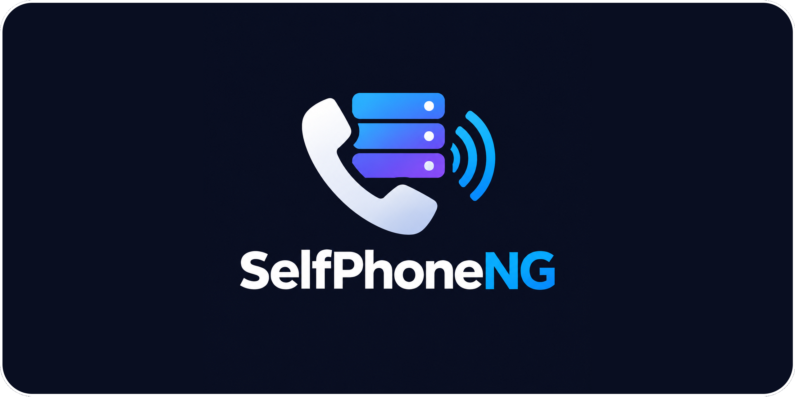

<p align="center">
  
</p>

# SelfPhoneNG

A fully open source, self-hosted business phone system: the everyday features of 3CX, on your
own server. You bring a SIP trunk and phone numbers (the reference provider is voip.ms);
SelfPhoneNG does the rest.

**Status:** pre-1.0 (v0.0.15), for testing. See [what's left for v1](docs/v1-checklist.md).

|               |                                                                                 |
| ------------- | ------------------------------------------------------------------------------- |
| **For**       | One small business or home lab: 1–100 extensions on one server                  |
| **Runs on**   | Linux with Docker Compose (or Portainer); 1–2 CPUs and 2 GB of memory is plenty |
| **Built on**  | Asterisk 24, TypeScript (Fastify + React), PostgreSQL 18                        |
| **You bring** | A SIP trunk with at least one number, and a DNS name for the server             |
| **License**   | AGPL-3.0-or-later; no closed-source parts                                       |

## What it does

### Calls and routing

- **Numbers and trunks:** voip.ms trunks (registration or IP auth, UDP/TCP/TLS with SRTP) or any
  other provider as a generic trunk; phone numbers routed to a person, group, queue, receptionist
  or voicemail.
- **Outbound rules** with calling permissions per extension, trunk failover, and limits on
  outside calls at once.
- **Digital receptionists** (press 1 for sales …), **office hours** and holidays with override
  codes, announcements.
- **Ring groups**, **queues**, call **parking** and **pickup**, **conference rooms**, **paging
  and intercom**, **music on hold**.
- **911:** always allowed, with an E911 caller ID, and an email, a ringing phone and a dashboard
  banner when someone dials it.

### Phones

- **Browser phone** for every user: hold, mute, keypad, blind and attended transfer, presence,
  click-to-call. Nothing to install.
- **Desk phones set up automatically:** Yealink and Grandstream (account, busy-lamp keys on
  Yealink, phonebook, time, dial rules). Polycom/Poly VVX and Snom are experimental.
- **Phone apps:** Linphone set up by scanning a QR code. Our own Android and iPhone app is in
  progress.
- **Anything else that speaks SIP**, analog adapters included, set up by hand from the details
  the admin pages show.

### Voicemail, history and recordings

- **Voicemail** with email, web playback, greetings recorded in the browser, and the light on
  desk phones.
- **Call history** for admins and for each person, with CSV export and call reports by email.
- **Call recording** per extension or number, with an optional announcement and retention rules.
- **Local AI** (optional, your own server or network only): voicemail transcripts, call
  transcripts and summaries, searchable.

### Queues and supervision

- **Live dashboard:** calls in progress, who is on the phone, trunks, queues and parked calls;
  listen, whisper or barge in.
- **Queue wallboard** for a screen on the wall: waiting callers, each agent's state, today's
  numbers.
- **Agent break reasons** (Lunch, Meeting …) picked on the web or dialed from the phone, shown
  on the wallboard and added up in reports.
- **Reports:** calls per day, missed calls, busiest hours, queue service levels, agent breaks,
  and each person's own numbers.

### Contacts and spam

- **Contacts:** a builtin company and personal phonebook, or
  [Contrack](docs/admin-guide/contacts.md). Caller names show on phones and in history.
- **Spam check** (off until you turn it on): outside callers who aren't contacts are looked up
  with IPQualityScore or the FTC complaint list and flagged. Calls are never blocked by it;
  blocking a number is your choice.

### Sign-in and security

- **Sign-in:** passwords, two-step sign-in for admins, passkeys, OpenID Connect (Keycloak and
  others) and LDAP / Active Directory.
- **Against toll fraud:** calling permissions, call limits, and alerts for international or
  premium calls, calls your provider billed that the phone system didn't make, and a falling
  balance.
- **Hardened by default:** SIP over TLS, an option to allow desk phones only from the office,
  no shell-running modules in Asterisk, an audit log, and notes for fail2ban and CrowdSec.

### Running it

- **Install** with one script; a setup wizard takes a new install to working calls.
- **Updates** with one command, with a backup before every database change and a roll-back when
  the new version doesn't start.
- **Backups** every night, a restore script, and health checks for the trunk, public IP and disk.
- **Integrations:** a REST API with tokens, and webhooks.

## Not there yet

| Wanted                               | Where it stands                                                               |
| ------------------------------------ | ----------------------------------------------------------------------------- |
| More SIP providers                   | Telnyx, Flowroute and Twilio first; today they work only as a generic trunk   |
| More desk phone makes                | Fanvil, Gigaset, Cisco; Polycom and Snom need trying on real phones           |
| Analog adapters set up automatically | Grandstream HT802 V2 first; by hand today ([how](docs/admin-guide/ata.md))    |
| Mobile app                           | Being built; without push, phone apps ring only while open                    |
| SMS                                  | Built for voip.ms, parked until wanted                                        |
| More local AI                        | Typed prompts, type-to-speak, an AI receptionist ([spec](docs/spec/10-ai.md)) |
| Recording prompts by phone           | Planned after v1                                                              |

**Not planned:** fax, video calls and team chat, several companies on one install, clustering.

## Getting started

You need a Linux server with Docker and the compose plugin, a DNS name pointing at it, and a
voip.ms account with a number.

```sh
git clone https://git.dou.bet/spng/selfphoneng.git
cd selfphoneng
./scripts/install.sh
```

The script asks for the host name and the first admin, then builds and starts everything (the
first build compiles Asterisk, so it takes a while). Open `https://<your host name>/`, sign in,
and follow the setup wizard. The [admin guide](docs/admin-guide/README.md) covers each step, the
ports to open and what to do when a call doesn't work.

## How it's put together

| Part         | What it does                                                                                |
| ------------ | ------------------------------------------------------------------------------------------- |
| **asterisk** | All SIP and audio: phones, the trunk, voicemail, queues, conferences, recording             |
| **api**      | Owns the database, writes Asterisk's config from it, follows calls live, serves the web app |
| **web**      | The admin pages, each person's portal and the browser phone (served by the api)             |
| **postgres** | Everything you set up, call history and the audit log                                       |
| **proxy**    | HTTPS: the bundled Caddy, or your own nginx                                                 |

PostgreSQL is the single source of truth: every change in the web app regenerates Asterisk's
config from it. Details in the [spec](docs/spec/00-overview.md).

## Docs

- **Installing and running:** the [admin guide](docs/admin-guide/README.md), with
  [voip.ms setup](docs/admin-guide/voipms.md), [network and firewall](docs/admin-guide/network.md),
  [updating and backups](docs/admin-guide/maintenance.md) and
  [troubleshooting](docs/admin-guide/troubleshooting.md).
- **Features:** [sign-in](docs/admin-guide/sign-in.md), [contacts](docs/admin-guide/contacts.md),
  [spam check](docs/admin-guide/spam-check.md), [local AI](docs/admin-guide/ai.md),
  [analog phones](docs/admin-guide/ata.md).
- **The law:** [E911 and call recording](docs/admin-guide/legal.md).
- **What changed:** the [changelog](CHANGELOG.md) and the
  [ready-for-v1 checklist](docs/v1-checklist.md).
- **Writing code** (people and AI alike): [`AGENTS.md`](AGENTS.md) first, then the
  [spec](docs/spec/00-overview.md) and the [roadmap](docs/spec/09-roadmap.md).

## Working on it

```sh
pnpm install
docker compose up -d postgres asterisk
pnpm dev                                    # api + web, reloading
pnpm lint && pnpm typecheck && pnpm test    # before calling anything done
```

## License

AGPL-3.0-or-later. Asterisk is GPL-2.0. Nothing closed-source is included or needed.
