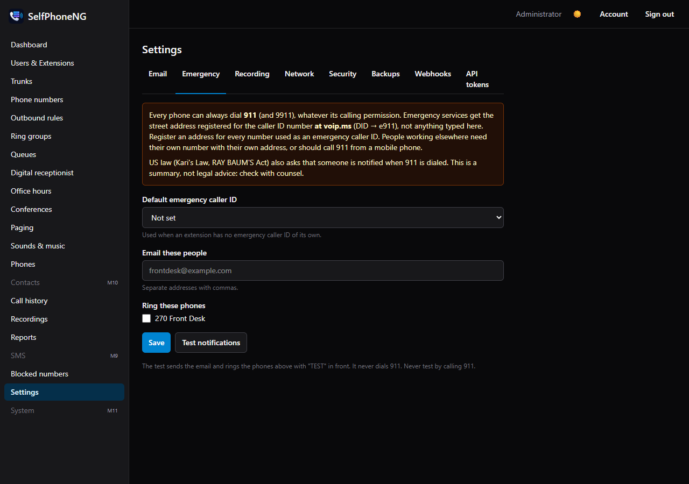
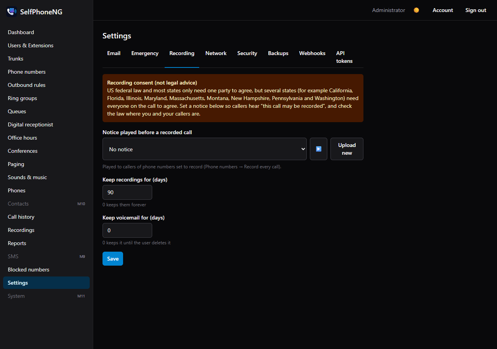

# Emergency calls and recording law

> This page explains what SelfPhoneNG does and what the law expects of you as the operator of a
> phone system. It is **not legal advice**. Rules differ by country, state and type of business:
> check with counsel for your situation.

## Emergency calls (E911)

In the US, two federal rules apply to multi-line phone systems like this one:

- **Kari's Law** (47 CFR 9.16):
  - anyone must be able to dial **911 directly**, with no prefix like 9 first;
  - when someone does, the system must **notify** someone on site (front desk, security) where
    that's set up.
- **RAY BAUM'S Act** (47 CFR 9.16(b)): a 911 call must carry a **dispatchable location**: the street
  address plus floor or room where that's needed to find the caller.

### What SelfPhoneNG does

- **911 and 9911 always work** from every extension.
  - This holds even if the extension may only call internally, is on do-not-disturb, or every
    trunk is busy.
  - Nothing you set can turn this off.
- **It tells people.** When someone dials 911, SelfPhoneNG:
  - emails the addresses in **Settings → Emergency → Email these people**;
  - rings the phones under **Ring these phones**;
  - shows a red banner on every admin's dashboard;
  - fires the `emergency.call` webhook.
- **It sends a caller ID that has an address.**
  - voip.ms gives the 911 operator the street address **registered on the number used as caller ID**.
  - That number is the extension's own **Emergency caller ID** (user → **Emergency** tab), or else
    the company's **Default emergency caller ID** (Settings → Emergency).

### What you must do

1. **Register an E911 address at voip.ms** for every number used as an emergency caller ID (DID →
   e911). This address is what the 911 operator gets.
2. **Pick a default emergency caller ID** on Settings → Emergency. The dashboard stays red until you
   do, and until that number's **E911 address** note is filled in on Phone numbers (a reminder that
   you registered it).
3. **Give people in other places their own number.**
   - Anyone who works somewhere else (another building, at home) needs an emergency caller ID whose
     E911 address is *where they are*.
   - Otherwise 911 is sent to the main office. Remote workers without such a number should call
     911 from a mobile phone, and must be told so.
4. **Fill in each person's Location** (e.g. "2nd floor, room 210") on their **Emergency** tab.
   - It goes into the notification email, so whoever is on site can meet the responders.
   - The 911 operator **does not** receive it. voip.ms only passes the registered street address.
     If a room number is needed to find someone in your building, register it in the voip.ms
     address itself.
5. **Test the notifications, never 911 itself.**
   - **Settings → Emergency → Test notifications** sends the email, rings the phones and shows the
     banner, all marked TEST. It dials nothing.
   - **Never place a real call to 911 to test.**
6. **Canada:** 911 works the same way through voip.ms. Check voip.ms's E911 documentation for
   Canadian rules.

## Call recording

Recording calls without the right consent can be a crime. In the US:

- Federal law and most states are **one-party consent**: one person on the call (you) agreeing
  is enough.
- Several states need **everyone on the call** to agree, for example California, Florida,
  Illinois, Maryland, Massachusetts, Montana, New Hampshire, Pennsylvania and Washington. A call
  between states can bring the stricter rule in.
- Other countries have their own rules; in the EU and UK, recordings are also personal data under
  the GDPR.

### What SelfPhoneNG does

- **Nothing is recorded unless you turn it on.** You can record:
  - every call to a number (**Phone numbers → Record every call**);
  - a queue's calls (the queue's **Record calls** switch);
  - one person's calls with outside numbers (Users & Extensions → the user → **Calling** →
    **Record calls**: calls from outside, calls to outside, or both).
  The setup wizard never turns recording on.
- **Settings → Recording → "Notice played before a recorded call"** plays a sound you upload
  (e.g. "This call may be recorded for quality and training") to everyone who calls a number set
  to record, before anything else. Upload it on **Sounds & music**.
- **Queue and per-person recordings play no notice of their own.** Only numbers set to record
  play it. If you record a queue or a person, make sure the callers still hear it: send them through
  a number that plays the notice, or through an announcement that says it (**Sounds & music →
  Announcements**: play a sound, then go on). For calls a person makes to the outside, tell them to
  say the call is recorded.
- **Retention.** Recordings and voicemail are deleted after the number of days you set there.
  0 keeps them.

### What you should do

- **Set the notice** whenever anything is recorded, even in one-party states. It's the simplest
  way to have consent from everyone.
- **Tell your staff** their calls are recorded (a written policy).
- **Keep recordings no longer than you need them**, and limit who can sign in as an admin:
  admins can play every recording.
