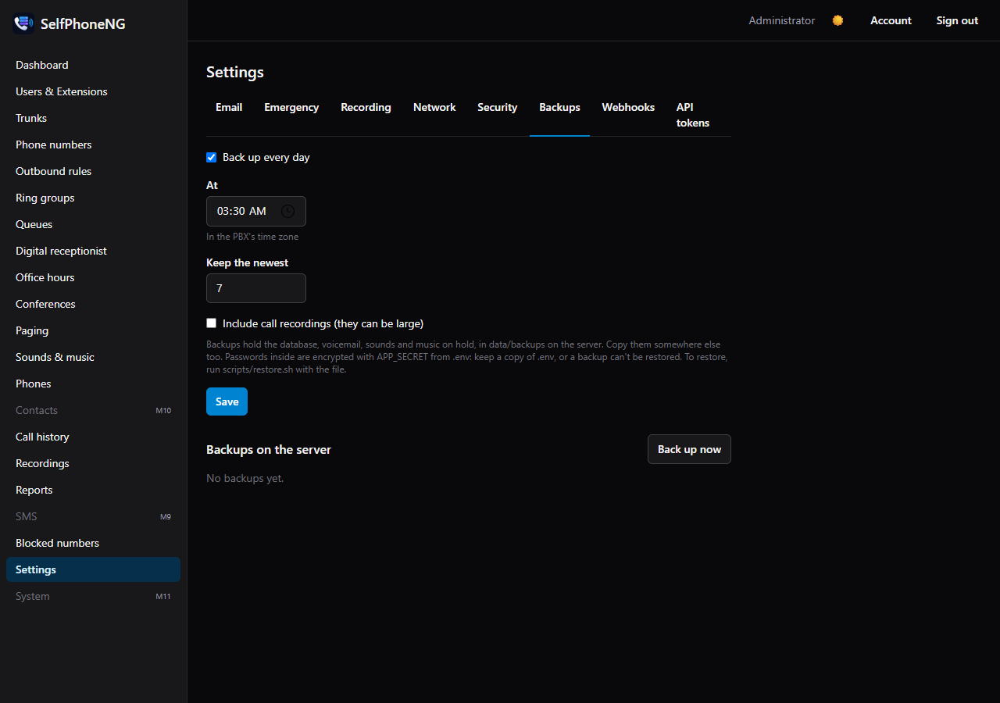

# Updating, backups and monitoring

## Updating SelfPhoneNG

SelfPhoneNG runs in Docker only. Each release has container images (`selfphoneng-api` and
`selfphoneng-asterisk`) and an entry in the [changelog](../../CHANGELOG.md). Read the entries
between your version and the new one first: anything you must do by hand, such as a new setting
for `.env` or the stack, is listed there under the version that needs it.

You don't run database upgrades yourself. When a new version starts and its database changes
haven't run yet, the api **backs up first** (into the backups folder, without recordings), then
makes the changes. If that backup fails (the backups folder is missing, read-only or full), the
api stops and leaves the database as it was, so the old version still works: fix the cause and
start it again. Only if you must update right away, set `SKIP_BACKUP_BEFORE_MIGRATE=true` for the
api, start it, and remove the setting afterwards.

Updates restart the api and Asterisk, which drops calls in progress. Pick a quiet time.

### Installed with `scripts/install.sh` (docker compose)

```sh
cd selfphoneng
sudo scripts/update.sh            # the newest release; or e.g. scripts/update.sh v0.0.3
```

The script:

1. Checks: Docker, that no files in the folder were changed, at least 3 GB free, and no calls in
   progress. It shows the changelog and any new `.env` settings, then asks before going on
   (`--yes` doesn't ask; `--force` goes on despite calls in progress, low disk space or a failed
   backup).
2. Backs up (database, voicemail, custom sounds and music on hold) and compacts Asterisk's logs
   (gzipped, kept 90 days).
3. Builds the new images while the old version keeps running, then restarts.
4. Checks that the api answers with the new version, Asterisk has started, and every trunk that
   was registered still is.
5. If the check fails, it goes back to the old version by itself, restoring the backup when the
   database was already changed.

Each run is logged in `data/update-logs/`, with one line per update in `data/update-logs/history`.

### Portainer, or another setup with pulled images

1. **Settings → Backups → Back up now**, and download the backup.
2. Change both image tags to the new version (for example `selfphoneng-api:0.0.3` and
   `selfphoneng-asterisk:0.0.3`), and add any new settings the changelog lists.
3. Redeploy the stack (in Portainer: **Update the stack**, with **Re-pull image** on).
4. Check: **System** (or **About**) shows the new version; trunks show
   **Registered**; make a test call.

Use exact version tags such as `0.0.3`, not `latest`, so you choose when to update.

**Going back:** an older version can't always run on a database a newer one changed, so going
back means the old tags **and** a backup from before the update: the one from step 1, or the one
the api made before changing the database. `scripts/restore.sh` is for compose installs; with a
stack, restore by hand. The stack's `APP_SECRET` must be the one the backup was made with.

1. Put the old tags back, and stop the api and Asterisk containers (Postgres keeps running).
2. Replace the database (`<postgres>` is your Postgres container's name):

   ```sh
   docker exec <postgres> psql -U selfphoneng -d postgres \
     -c 'DROP DATABASE IF EXISTS selfphoneng WITH (FORCE)' -c 'CREATE DATABASE selfphoneng OWNER selfphoneng'
   tar -xzOf selfphoneng-20261021-0300.tar.gz db.sql | docker exec -i <postgres> psql -q -U selfphoneng -d selfphoneng
   ```

3. Replace the folders the backup has (`tar -tzf` lists them: `voicemail`, `sounds-custom`, `moh`,
   maybe `recordings`) in your data folder, and give them back to the app user:
   `tar -xzf selfphoneng-….tar.gz -C <data folder> voicemail sounds-custom moh` after removing the
   old ones, then `chown -R 1000:1000` them.
4. Start Asterisk and the api. The api rebuilds Asterisk's config from the restored database.

### Asterisk security releases

SelfPhoneNG builds Asterisk from source, checking the download against Asterisk's published
checksum. New Asterisk versions come with SelfPhoneNG updates.

To take an Asterisk fix before that, build the version you need yourself. Release numbers are
listed at <https://downloads.asterisk.org/pub/telephony/asterisk/releases/>.

```sh
docker compose build --build-arg ASTERISK_VERSION=24.0.1 asterisk
docker compose up -d asterisk
docker compose exec asterisk asterisk -rx "core show version"
```

A later rebuild without `--build-arg` goes back to the version the code names.

## Backups

**Settings → Backups:**

- **Back up every day** at a time you choose, keeping the newest few.
- **Back up now** makes one right away.
- The list downloads any of them.



A backup (`data/backups/selfphoneng-YYYYMMDD-HHMM.tar.gz`) holds:

- the database: users, extensions, numbers, settings, call history;
- voicemail;
- your sounds and music on hold;
- call recordings, if you tick **"Include call recordings"** (they can be large).

If a daily backup fails, the admins get an email, and the dashboard warns while today's backup is
missing.

**Two things a backup doesn't hold:**

1. **`.env`.** Its `APP_SECRET` encrypts the SIP and trunk passwords inside the backup.
   - **A backup can only be restored with the `.env` it was made with**, so keep a copy of `.env`
     in a password manager.
   - The backup itself holds no plain passwords.
2. **A copy anywhere else.** Backups sit on the same disk as the system. Copy them off the server
   regularly, e.g. with a nightly cron job:
   `rsync -a /opt/selfphoneng/data/backups/ backup-host:selfphoneng/`.

## Restoring

```sh
./scripts/restore.sh /path/to/selfphoneng-20261019-0300.tar.gz
```

The script:

- refuses if `.env`'s `APP_SECRET` isn't the one the backup was made with;
- shows what the backup holds and asks you to type `yes`;
- replaces the database and those folders, then starts everything again.

Asterisk's config is rebuilt from the restored database. Sign in with the passwords from the
backup.

### Moving to a new server

1. Clone SelfPhoneNG on the new server.
2. **Copy your old `.env`** into the folder.
3. Run `./scripts/install.sh`. It keeps the existing `.env`.
4. Run `./scripts/restore.sh <backup>`.
5. If the public IP changed: update it on **Settings → Network**, change your DNS record and any
   IP-based settings at voip.ms (IP authentication, API whitelist), then
   `docker compose restart asterisk`.
6. Desk phones fetch their setup from the host name, so they follow the DNS change.

## Monitoring

**Emails to admins.** SelfPhoneNG emails every admin when:

- a trunk has been down for 5 minutes (one email per outage);
- the disk is under 10% free (once a day);
- the public IP changed (with the re-check turned on);
- a daily backup failed.

These need **Settings → Email** working.

**Health check** for an uptime monitor (Uptime Kuma or similar), on the server itself:

```sh
curl http://127.0.0.1:8080/healthz      # 200 {"ok":true}, or 503 when the database is down
```

From outside, monitor `https://pbx.example.com/healthz`.

**The dashboard** shows trunks, active calls, queues and warnings (emergency setup, certificate,
backups, restart needed) live. **System** has the event log: trunks going down and back up,
Asterisk stopping and coming back, restarts needed, 911 calls, public IP changes, backups and a full
disk, kept 90 days (**Download** saves it as CSV).

### Keeping logs small

Asterisk's log files in `data/asterisk-logs/` grow forever. Rotate them with logrotate. Create
`/etc/logrotate.d/selfphoneng`:

```
/opt/selfphoneng/data/asterisk-logs/*.log {
    weekly
    rotate 8
    compress
    delaycompress
    missingok
    notifempty
    copytruncate
}
```

`copytruncate` lets Asterisk keep writing to the same file. fail2ban and CrowdSec notice the file
shrinking.

`scripts/update.sh` also compacts them on every update (gzipped next to the log, kept 90 days).

The api's logs are Docker's. `docker-compose.yml` keeps three files of 10 MB per container. In a
Portainer stack, add the same to each service:

```yaml
    logging:
      driver: json-file
      options: { max-size: 10m, max-file: '3' }
```

Or set it for every container in `/etc/docker/daemon.json` with
`"log-opts": {"max-size": "20m", "max-file": "5"}`, restart Docker, then recreate the containers
(the limit only applies to new ones).
