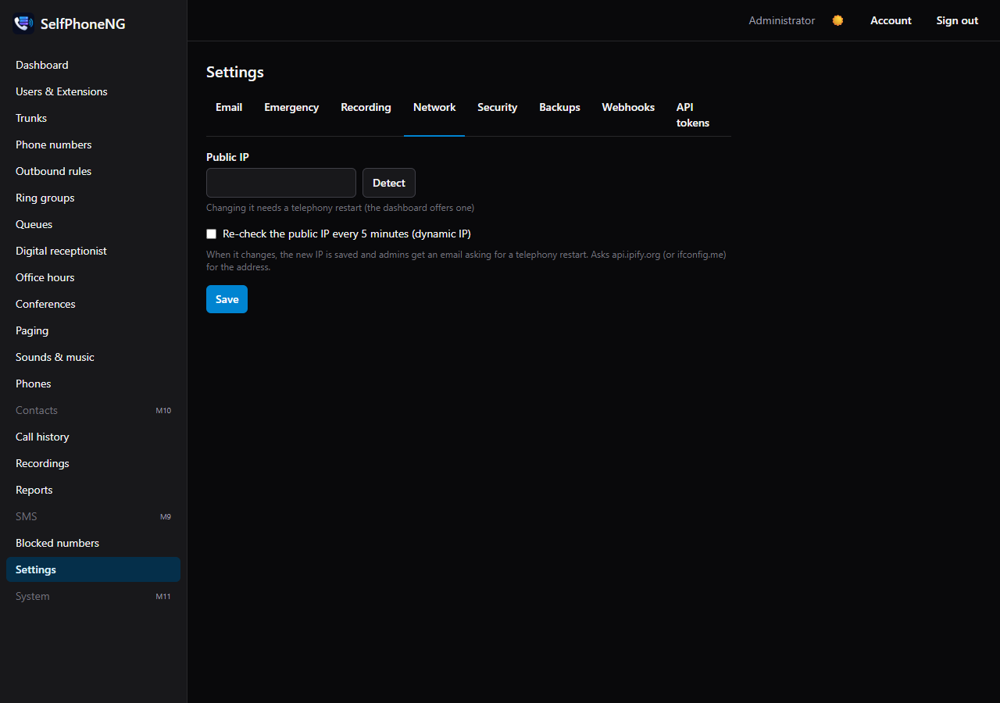

# Network, firewall and attacks

Most call problems come from the network between the server and the internet, and any PBX on the
internet is attacked within hours of going up. This page covers both.

## NAT: a server behind a router

Calls carry the server's address inside the SIP messages. Behind a router (NAT), the server has to
know its **public IP** and which networks are **local**, or the other side sends the audio to
the wrong place.

1. **Turn off SIP ALG** (also called "SIP helper" or "SIP fixup") on every router between the
   server and the internet. It rewrites SIP messages and is the classic cause of one-way audio and
   calls dropping after 30 seconds. Where to find it depends on the router; search for
   "<router model> disable SIP ALG".
2. **Forward ports** to the server's LAN IP:
   - UDP 5060 (SIP);
   - UDP 10000–20000 (audio);
   - TCP 443 (and 80 with the bundled Caddy);
   - TCP 5061 only if you use SIP over TLS.
3. **Double NAT** (the ISP's box in front of your own router): forward the ports on both, or put
   your router in the ISP box's DMZ / bridge mode.
4. **Public IP and local networks.**
   - The wizard's Network step sets both (go back to it at `/setup?step=3`).
   - The public IP is also on **Settings → Network**: **Detect** fills it in.
   - Local networks are the networks that reach the server without NAT. The default
     (`192.168.0.0/16, 10.0.0.0/8, 172.16.0.0/12`) fits most offices.
5. **Dynamic IP?** Tick **"Re-check the public IP every 5 minutes"** on Settings → Network.
   - When the IP changes, SelfPhoneNG updates its settings and emails the admins
     ("Public IP changed to …").
   - **Then restart telephony** so Asterisk uses the new address: on the server, run
     `docker compose restart asterisk` (calls in progress drop). The dashboard shows "SIP port or
     transport changes need a telephony restart" until you do, and **System** shows the command.



## Firewall

Allow only the ports in the [port table](README.md#ports). All SelfPhoneNG containers use the
host's network, so the host firewall (ufw, firewalld, nftables) applies to them directly.

With **ufw**:

```sh
ufw allow OpenSSH
ufw allow 443/tcp
ufw allow 80/tcp                 # only with the bundled Caddy
ufw allow 5060/udp
ufw allow 10000:20000/udp
ufw enable
```

### Only voip.ms may reach SIP (no remote phones)

If every desk phone is in the office, nothing else on the internet needs port 5060. Limit it to
voip.ms and your local networks.

1. **Look up your POP's address** (the server you put on the trunk):

   ```sh
   dig +short chicago1.voip.ms
   ```

2. **Save this as `/etc/nftables.d/selfphoneng.nft`**, with that address in `sip_ok`. Add any
   other office that has phones (the same networks as Settings → Security → "Other networks
   allowed").

   ```nft
   table inet selfphoneng {
     set sip_ok {
       type ipv4_addr
       flags interval
       elements = { 10.0.0.0/8, 172.16.0.0/12, 192.168.0.0/16, 208.100.60.8 }
     }
     chain input {
       type filter hook input priority 0; policy accept;
       meta l4proto { tcp, udp } th dport { 5060, 5061 } ip saddr != @sip_ok drop
       meta nfproto ipv6 meta l4proto { tcp, udp } th dport { 5060, 5061 } drop
     }
   }
   ```

3. **Load it:** `nft -f /etc/nftables.d/selfphoneng.nft`. To keep it after a reboot, include it
   from `/etc/nftables.conf`.

This table only drops SIP from elsewhere and leaves your other rules alone. voip.ms can change
its addresses: if the trunk stops registering one day, run `dig` again.

## Desk phones only from the office

**Settings → Security → "Only accept desk phones from the networks below"** makes Asterisk refuse
desk phones signing in from anywhere but your local networks and the ones you list. A stolen phone
password is then useless from outside.

- Browser phones aren't affected: they come in through HTTPS.
- **"Only to phones on the local networks"** does the same for the phone setup files.

## Blocking password guessers: fail2ban or CrowdSec

Asterisk writes every failed sign-in to `data/asterisk-logs/security.log`. Use one of the two tools
below; both read that file on the host.

### fail2ban

Install it (`apt install fail2ban`) and create `/etc/fail2ban/jail.d/selfphoneng.conf`. Change
the path to where you cloned SelfPhoneNG:

```ini
[asterisk]
enabled  = true
logpath  = /opt/selfphoneng/data/asterisk-logs/security.log
maxretry = 5
findtime = 10m
bantime  = 1d
# never ban your own offices
ignoreip = 127.0.0.1/8 ::1 10.0.0.0/8 172.16.0.0/12 192.168.0.0/16
```

Then:

```sh
systemctl restart fail2ban
fail2ban-client status asterisk
```

The stock `asterisk` filter already understands the log. We test it against real failed
sign-ins (`scripts/e2e/m11-t7.mjs`).

### CrowdSec

Install CrowdSec and a bouncer (<https://docs.crowdsec.net/>), then:

```sh
cscli collections install crowdsecurity/asterisk
```

Add `/etc/crowdsec/acquis.d/selfphoneng.yaml`:

```yaml
filenames:
  - /opt/selfphoneng/data/asterisk-logs/security.log
labels:
  type: asterisk
```

and run `systemctl reload crowdsec`.

## Web sign-in attacks

The web sign-in is rate limited. Failed attempts are written to the api's log as
`"event":"auth.failed"` with the `ip`, so you can feed them to fail2ban or CrowdSec too
(`docker compose logs api`). Turn on two-step sign-in for every admin.

## Toll fraud

Someone with a stolen SIP password calling expensive international numbers is the attack that costs
real money. Keep:

- international calling **off** at voip.ms and in **Outbound rules** unless you need it;
- the voip.ms **balance alerts and spending limits** on;
- the **desk phone network limit** above on if your phones are all in the office;
- the **outside calls at once** limits (Settings → Security) as low as your office needs: per
  extension (3 by default) and for the whole system (10). A stolen password then runs up at most
  that many calls at a time. Forwarded calls count for the person who set the forward; 911 is
  never limited. Callers over a limit hear "all circuits are busy".

Never reuse a SIP password. SelfPhoneNG generates long random ones; phones get them from the
setup files.
