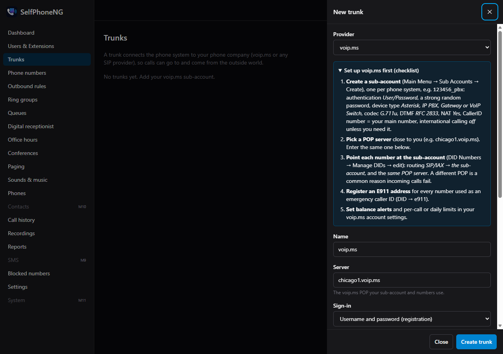
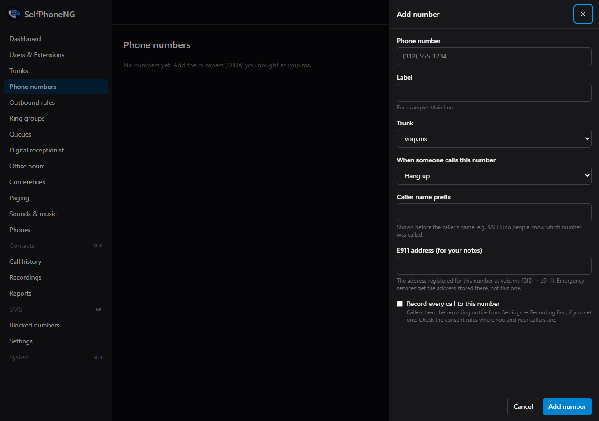

# voip.ms setup

SelfPhoneNG connects to voip.ms through a **sub-account**. voip.ms changes its portal now and
then; if a menu name below doesn't match, look for the closest one.

## 1. In the voip.ms portal

1. **Create a sub-account** (Main Menu → Sub Accounts → Create Sub Account). Use one sub-account
   per phone system, e.g. `123456_pbx`.
   - **Authentication type:** User/Password. If your server has a fixed public IP, IP
     authentication works too.
   - **Password:** long and random. You'll paste it into SelfPhoneNG, not type it into phones.
   - **Device type:** Asterisk, IP PBX, Gateway or VoIP Switch.
   - **Allowed codecs:** G.711u (ulaw). Others are optional.
   - **DTMF mode:** RFC 2833.
   - **NAT:** Yes.
   - **CallerID number:** your main number.
   - **International calling:** leave it **off** unless you need it. It's your best protection
     against toll fraud if a password ever leaks.
   - **Encrypted SIP traffic (TLS/SRTP):** optional; see [SIP over TLS](#sip-over-tls).
2. **Pick a POP server** near the PBX, e.g. `chicago1.voip.ms`. Write it down: the trunk and every
   number must use the same one.
3. **Point each number at the sub-account** (DID Numbers → Manage DIDs → edit the number):
   - **Routing:** SIP/IAX → your sub-account.
   - **POP:** the **same server** as above. A different POP is the most common reason incoming
     calls don't arrive.
4. **E911:** register a street address on every number you'll use as an emergency caller ID
   (DID → e911). Read [Emergency calls](legal.md#emergency-calls-e911) first.
5. **Balance protection:** set a low-balance alert and the daily or per-call spending limits voip.ms
   offers, so a stolen password can't run up a big bill.
6. **(Optional) API access**, for importing your numbers and the server list: Main Menu → SOAP
   and REST/JSON API. Enable it, set an API password and allow your server's public IP.

## 2. The trunk in SelfPhoneNG

**Trunks → New trunk** (or the wizard's Trunk step). The form has the same checklist built in.

| Field | What to enter |
|---|---|
| Provider | voip.ms |
| Server | The POP you picked, e.g. `chicago1.voip.ms` |
| Sign-in | Username and password (registration); IP address only if you set the sub-account to IP authentication |
| Username | The sub-account, e.g. `123456_pbx` |
| Password | The sub-account's password |
| Transport / Port | UDP 5060 (TLS 5061 if you turned encryption on) |
| voip.ms API (optional) | Your voip.ms email and the API password. Fills the server list and lets you import numbers. |

Save, then:

- Within a few seconds the trunk shows **Registered**.
- **Test** checks that the server answers.
- **Rejected** means the username or password is wrong. **Not registered** means Asterisk can't
  reach the server. See [Troubleshooting](troubleshooting.md#the-trunk-wont-register).

## 3. Phone numbers

On **Phone numbers**, either:

- use **Add number**: the 10-digit number, a label, and where its calls go; or
- on the trunk form, use **Import numbers from voip.ms** (needs the API details) and route each
  number afterwards. Imported numbers hang up until you route them.

Each number can also:

- record every call (see [recording law](legal.md#call-recording));
- have **office hours**;
- have an **E911 address** note: a reminder of what you registered at voip.ms. 911 calls don't
  use it; voip.ms sends the address registered there.

## 4. Outbound calls

The wizard creates the outbound rules for:

- North American numbers (sent as 11 digits);
- toll-free numbers;
- international numbers, created **turned off**.

Turn international on under **Outbound rules** only if you need it, and give it only to the users
who need it (the user's **Calling** tab).

911 always works from every extension, whatever its rules (see [E911](legal.md#emergency-calls-e911)).

## SIP over TLS

TLS encrypts the call setup between SelfPhoneNG and voip.ms; SRTP encrypts the audio.

1. **Get a certificate into `data/tls`.**
   - With the bundled Caddy: run `./scripts/tls-cert.sh`. It copies Caddy's certificate for your
     host name.
   - With your own certbot certificate:
     `./scripts/tls-cert.sh /etc/letsencrypt/live/pbx.example.com/fullchain.pem /etc/letsencrypt/live/pbx.example.com/privkey.pem`
2. **Keep it renewed.** Run the same command every day from cron; it does nothing when the
   certificate hasn't changed, e.g.
   `17 4 * * * cd /opt/selfphoneng && ./scripts/tls-cert.sh`.
3. **Turn it on.** **Settings → Security → Accept SIP over TLS**, then restart telephony
   (`docker compose restart asterisk`), and open TCP 5061.
4. **Set the trunk and voip.ms.** Set the trunk's transport to TLS (port 5061) and turn on
   encryption on the voip.ms sub-account.

The dashboard warns when the certificate is missing or expires within 14 days.
